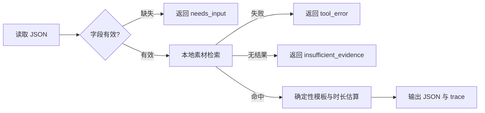

# 方案

| 模块 | 实现 |
|---|---|
| CLI | src/main.py:main |
| 工作流 | src/main.py:run |
| 知识 | data/materials.json |
| 状态 | needs_input / tool_error / insufficient_evidence / duration_exceeded / completed |

选择标准库是为了让评审无需密钥和依赖即可复现。未使用多 Agent、向量库或记忆，因为本演示不需要它们。
真实候选人应按题目接入模型生成、检查器和必要工具；固定模板不能代替真实生成能力的证据。
时长按每秒四个字符粗估，仅用于演示边界检查，不是语音时长测量。
